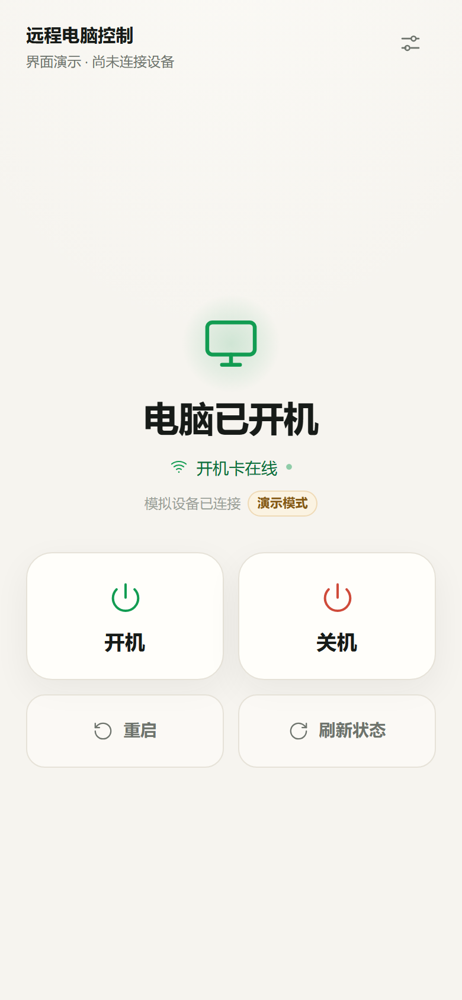
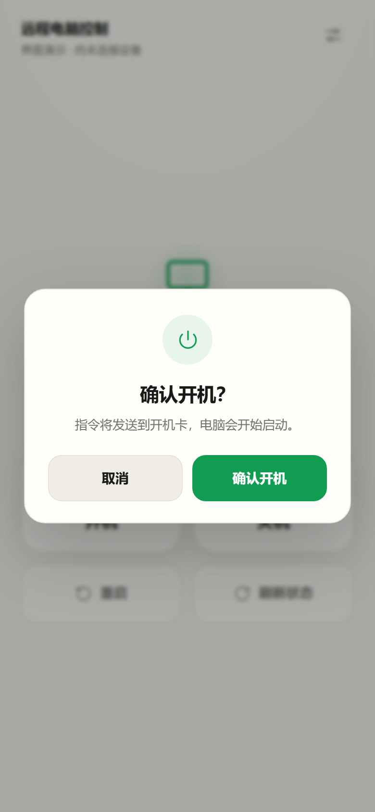
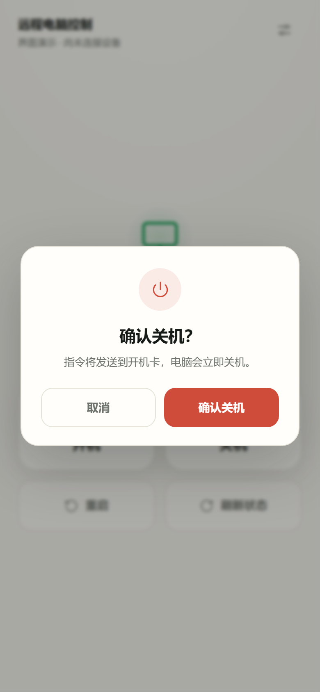
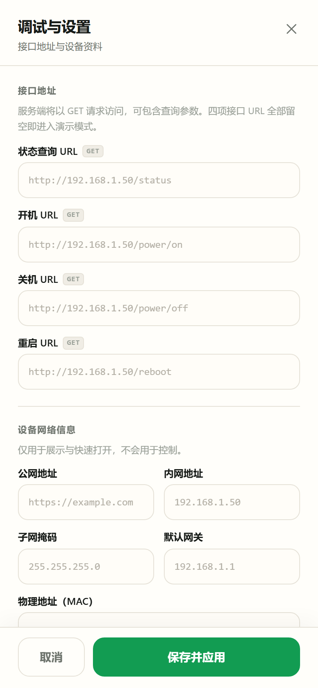

# 远程电脑控制 · Android APK

一个给「电脑远程开机卡」用的手机控制 App：打开就能看到开机卡是否在线、电脑是否开机，用两个大按钮开机 / 关机，两个小按钮重启 / 刷新状态，右上角调试按钮配置接口 URL。

**v1.1.0 新增桌面小组件**：4×2 / 2×2 两套尺寸，桌面直接看状态、开机 / 关机 / 刷新，开机和关机都采用小组件内两段式二次确认，不跳转 App。

**这一版是独立的 Android APK，不需要电脑、Node 服务或任何外部服务器。** 所有状态查询、开机、关机、重启请求都由手机原生网络层直接发往你配置的 URL。原来的网页 + Node 代理版本保留为可选的桌面/浏览器工具，APK 不依赖它。

- 安装包：[`dist/PowerCard-v1.1.0.apk`](dist/PowerCard-v1.1.0.apk)（1,722,546 字节）
- SHA-256：`5af3560855f5707ae0718f86daedd1bc69b72eeda71f32ec0dacc39d7fb22599`
- 包名：`com.powercard.remote` · versionName `1.1.0`
- 支持：Android 8.0（API 26）及以上
- 权限：仅网络（INTERNET / ACCESS_NETWORK_STATE）



| 开机确认 | 关机确认 | 调试与设置 |
| --- | --- | --- |
|  |  |  |

> 截图来自同一套 UI 的浏览器自动化验收；APK 内嵌的页面与它完全一致。

## 目录

- [安装 APK](#安装-apk)
- [第一次配置](#第一次配置)
- [功能说明](#功能说明)
- [桌面小组件](#桌面小组件)
- [为什么不需要服务器](#为什么不需要服务器)
- [网络与 URL 说明](#网络与-url-说明)
- [状态识别](#状态识别)
- [安全设计](#安全设计)
- [从源码构建 APK](#从源码构建-apk)
- [可选的网页版](#可选的网页版)
- [测试](#测试)
- [常见问题](#常见问题)
- [已知限制](#已知限制)

## 安装 APK

1. 把 `dist/PowerCard-v1.1.0.apk` 传到手机（微信文件传输、数据线、网盘均可）。
2. 在手机上点击 APK。系统提示「禁止安装未知应用」时，允许当前文件管理器/浏览器安装。
3. 安装完成，桌面出现「远程电脑控制」图标。
4. 打开 App。第一次是**演示模式**（四项接口 URL 为空），不会操作真实电脑。

升级时请安装同一签名的更高版本 APK，不要卸载重装，否则本地配置会丢失。

## 第一次配置

点页面右上角的**调试按钮**（滑杆图标），填写：

| 字段 | 说明 |
| --- | --- |
| 状态查询 URL | 开机卡提供的状态接口，例如 `https://.../device/control?action=status&token=...` |
| 开机 URL | `...action=on...`（以你的开机卡说明书为准） |
| 关机 URL | `...action=off...` |
| 重启 URL | `...action=reboot...` |
| 公网地址 / 内网地址 | 设备资料，仅展示和快速打开，不参与请求 |
| 子网掩码 / 默认网关 / 物理地址 | 设备资料，仅展示 |
| 电源状态字段 / 在线状态字段 | 可选；设备返回字段特殊时手动指定，如 `data.power` |
| 轮询间隔 / 请求超时 / 操作二次确认 | 默认 10 秒 / 5 秒 / 开启 |

建议顺序：

1. 填状态查询 URL；
2. 点 **「测试状态接口」**，确认显示「接口可用 / 在线 / 已开机」；
3. 填齐开机、关机、重启 URL；
4. 点 **「保存并应用」**，回到首页。

四项 URL 全部留空 = 演示模式；填入任意 URL 并保存 = 真实设备模式。

## 功能说明

- **状态显示**：开机卡在线 / 离线、电脑已开机 / 已关机 / 状态未知、最后更新时间和请求耗时。
- **大按钮**：开机、关机。
- **小按钮**：重启、刷新状态。
- **二次确认**：开机、关机、重启默认都弹确认框；可在设置里关闭「操作二次确认」。
- **轮询**：默认每 10 秒刷新；App 切到后台暂停，回前台立即刷新。
- **调试**：保存前测试连接、查看原始响应、加载最近 30 条请求记录。
- **演示模式**：没填 URL 时可完整体验界面，开关机只改内存模拟状态。
- **桌面小组件（v1.1.0 新增）**：4×2 标准版 / 2×2 紧凑版，桌面直接显示开关机状态和在线状态，支持开机 / 关机 / 刷新；开机、关机同样两段式二次确认。

## 桌面小组件

### 添加

1. 打开 App → 右上角调试按钮 → 「桌面小组件」；
2. 点 **「添加到桌面」**；
3. 系统弹出确认后，小组件会放到桌面；
4. 长按小组件拖动边缘，可调整为 **4×2** 或 **2×2** 紧凑尺寸。

如果启动器不支持自动添加，设置页会提示：长按桌面空白处 → 小组件 → 选择「电脑开关机」。

### 显示与操作

```text
4×2：
┌──────────────────────────────────┐
│ 电脑已开机                        │
│ 开机卡在线 · 15:25                │
│ [   开机   ] [   关机   ] [刷新]  │
└──────────────────────────────────┘

2×2（紧凑）：
┌──────────────────┐
│ 电脑已开机        │
│ 开机卡在线·15:25  │
│ [开机] [关机] [刷新] │
└──────────────────┘
```

- **两段式二次确认**：第一次点开机/关机，小组件变成「确认开机？/确认关机？」+ 取消/确认；第二次点确认才真正发 GET；超过 30 秒失效，下次刷新/点击时恢复普通态。小组件的二次确认**始终开启**，不受 App 内「操作二次确认」开关影响。
- **刷新**：点「刷新」立即请求状态；App 保存配置、执行开关机后也会通知小组件刷新。
- **自动刷新**：系统周期更新约 30 分钟（Android 限制），显示“最后更新时间”。
- **未配置**：显示「未配置 · 打开 App 设置」，点击进入 App，不显示假状态。
- **失败**：保留上次成功状态和更新时间，显示“连接失败”；点刷新重试。
- 桌面小组件只提供开机 / 关机 / 刷新，**没有重启按钮**（重启仍在 App 内操作）。

> 已知限制：小组件不是实时后台轮询；系统更新周期约 30 分钟，操作/刷新后会立即更新。

## 为什么不需要服务器

浏览器直接请求开机卡接口会遇到两个问题：

1. 开机卡通常不返回 CORS 头，网页读不到响应；
2. 页面如果是 HTTPS，请求局域网 `http://` 会被混合内容拦截。

APK 里没有用网页的 `fetch` 发设备请求，而是：

```text
Android WebView（本地界面）
        │  /api/* 由 native-bridge.js 拦截
        ▼
Java 原生桥（PowerCardNative）
        │  HttpURLConnection GET（手机 Wi-Fi / 移动数据）
        ▼
开机卡状态 / 开机 / 关机 / 重启 URL
```

所以：

- 不需要 Node、不需要电脑常开、不需要 NAS；
- 不存在 CORS；
- 局域网明文 HTTP 由 `usesCleartextTraffic=true` 放行；
- 配置用 Android Keystore AES/GCM 加密后保存在 App 私有目录，`allowBackup=false`，不进云备份；
- App 不打印完整 URL / token 日志。

## 网络与 URL 说明

- APK 只保存**一套** 4 个 URL，不区分内网/公网两套配置。
- 只要这套 URL 在手机当前网络（Wi-Fi 或移动数据）下可以访问，App 就能正常控制。
- 手机连着的 Wi-Fi 如果实际访问不了该 URL，Android 不会自动改用移动数据；需要手动关闭 Wi-Fi 或换网络。这是系统路由行为。
- 公网地址、内网地址、子网掩码、网关、MAC 只是设置页资料，不参与请求。
- 支持 `http://` 和 `https://`。HTTPS 使用 Android 系统证书；**自签名证书默认不受信任**（见已知限制）。

## 状态识别

服务端/APK 会把设备返回统一成：

- `power`: `on` / `off` / `unknown`
- `online`: `true` / `false`

支持常见 JSON、纯文本、HTML：

```json
{ "online": true, "power": "on" }
```

```json
{ "status": 0, "msg": "OK", "data": { "online": true, "power": "on" } }
```

```text
power=on
online=1
```

也兼容 `开机 / 关机 / 已开机 / 已关机 / running / stopped / 1 / 0 / true / false` 等写法。

如果自动识别不到，可以：

1. 在设置页点「查看原始响应」；
2. 按实际结构填「电源状态字段」，如 `data.power`；
3. 点「测试状态接口」验证后再保存。

HTML 同时包含「开机」「关机」按钮时不会瞎猜电源状态。

## 安全设计

- 设备 URL 里的 token 等于控制权限，请勿截图公开或把 APK 转给他人。
- 配置使用 Android Keystore（不可导出密钥）+ AES/GCM 加密存储。
- `allowBackup=false`，避免 token 被系统备份到云端。
- 只允许 `http/https` URL；设备请求只使用 GET。
- WebView 只加载 APK 内置的本地资源，禁止 file/content 访问；外部链接交给系统浏览器。
- release APK 关闭 WebView 调试。
- 开机、关机、重启默认二次确认，防止误触。

## 从源码构建 APK

### 环境

- Windows
- JDK 17、Gradle 8.9、Android SDK 35 / build-tools 35.0.0（可用仓库内 `.android-toolchain/`，不需要 Android Studio）
- Node.js 仅用于辅助脚本，不参与 APK 运行时

详细工具链准备见 [`docs/android-build.md`](docs/android-build.md)。

### 一键构建

```powershell
powershell -ExecutionPolicy Bypass -File scripts\build-android.ps1
```

脚本会：

1. 同步仓库根 `public/` 到 `android/app/src/main/assets/public/`；
2. 构建 debug + release；
3. 复用/生成 release keystore；
4. 输出 `dist/PowerCard-v1.1.0.apk` 和 SHA-256；
5. 执行 apksigner、aapt2、APK 内容校验。

只构建 debug：`... -Target debug`；只构建 release：`... -Target release`。

### 签名

- `android/keystore/powercard-release.jks`（PKCS12，RSA 2048）
- 口令：`android/keystore/keystore.properties`
- 两者已加入 `.gitignore`，不会提交。**请备份 `android/keystore/`**；丢失后无法覆盖升级已安装的 App。

### 工程结构

```text
android/
├─ app/src/main/java/com/powercard/remote/
│  ├─ MainActivity.java          WebView 壳 / 安全区 / 返回键
│  ├─ NativeBridge.java          window.PowerCardNative 注入
│  ├─ NativeHttpClient.java      原生 GET、超时、错误映射
│  ├─ SecureConfigStore.java     Keystore AES/GCM 配置加密
│  ├─ RootAssetsPathHandler.java 本地资源兜底
│  ├─ PowerCardWidgetProvider.java 桌面小组件广播入口
│  ├─ WidgetRenderer.java        RemoteViews 4×2/2×2/确认态
│  ├─ WidgetRefresher.java       状态刷新/指令/延迟刷新
│  ├─ WidgetStateParser.java     Java 状态解析（小组件无 WebView）
│  ├─ WidgetStore.java           状态缓存 + per-widget pending
│  ├─ WidgetConfig.java / WidgetContract.java / WidgetPin.java
│  └─ ...
├─ app/src/main/res/layout/widget_powercard_*.xml
├─ app/src/main/res/xml/widget_info.xml
├─ app/src/test/java/...        Java 解析器/配置单测
├─ app/src/main/assets/public/  构建时从根 public/ 同步（gitignore）
└─ tools/generate-icons.py      mipmap 图标生成
dist/
├─ PowerCard-v1.1.0.apk
├─ PowerCard-v1.1.0.apk.sha256
├─ PowerCard-v1.1.0-debug.apk   仅调试用，非最终交付
└─ PowerCard-v1.0.0*           上一版回退包
```

## 可选的网页版

仓库仍保留原来的 PWA + Node 代理版本，用于电脑浏览器/局域网网页访问：

```powershell
npm start
# http://127.0.0.1:8787
```

网页版需要 Node 常开，且最好运行在 NAS/树莓派等设备上；**APK 不需要它**。网页版的 `/api` 代理、PWA、测试与文档仍然保留。

## 测试

```powershell
# Node 单元 + 集成测试（90 用例）
$env:NODE_OPTIONS='--test-isolation=none'; npm test

# 网页端 E2E（18 用例，含开机/关机/重启确认）
npm run test:e2e

# 原生模式模拟（7 用例：注入 PowerCardNative，含小组件入口/刷新通知）
npm run test:native
```

Android 侧小组件 Java 单测：

```powershell
cd android
..\.android-toolchain\gradle-8.9\bin\gradle.bat :app:testDebugUnitTest --no-daemon
# 29/29：WidgetStateParserTest 24 + WidgetConfigTest 5
```

APK 校验：

```powershell
.android-toolchain\android-sdk\build-tools\35.0.0\apksigner.bat verify --verbose dist\PowerCard-v1.1.0.apk
.android-toolchain\android-sdk\build-tools\35.0.0\aapt2.exe dump badging dist\PowerCard-v1.1.0.apk
Get-FileHash -Algorithm SHA256 dist\PowerCard-v1.1.0.apk
```

测试说明与结果见 [`docs/qa-report.md`](docs/qa-report.md)、[`docs/android-qa-report.md`](docs/android-qa-report.md)、[`docs/widget-qa-report.md`](docs/widget-qa-report.md) 和 [`docs/android-build.md`](docs/android-build.md)。

## 常见问题

**安装被拦截？**

允许文件管理器/浏览器「安装未知应用」；APK 是本地签名，不是应用商店包。

**App 显示「状态未知 / 无法访问设备」？**

- 在设置里点「测试状态接口」看具体错误；
- 检查手机当前 Wi-Fi/移动数据能否访问该 URL；
- 检查 URL 是否以 `http://` 或 `https://` 开头；
- 看「最近请求」里的 HTTP 状态和耗时。

**点开关机没反应？**

- 确认开机/关机/重启 URL 已填写并保存；
- 看二次确认弹窗是否已确认；
- 看 toast 和「最近请求」中的错误。

**换了手机/重装 App，配置没了？**

配置只存在本机加密存储；卸载/清除数据会删除。重新填写即可。

**需要公网访问？**

把开机卡的公网 URL 填进去，手机用移动数据访问。若 URL 只能内网访问，外网无法使用。

**能上架应用商店吗？**

当前是本地 release 签名，适合自用/侧载；上架需要按商店要求调整签名、隐私声明、targetSdk 等。

## 已知限制

- 本机没有 Android 真机/模拟器（CPU 虚拟化未开启），**未做真机安装后的运行验证**；已完成 APK 构建、签名、静态校验和原生模式浏览器 E2E。首次真机安装如遇问题，请把现象/截图反馈。
- 需要较新的 Android System WebView（建议 100+）。`minSdk 26` 只代表 Android 版本，若设备 WebView 很旧且从未更新，页面脚本可能无法运行；请在应用商店更新「Android System WebView」。
- 自签名 HTTPS 证书默认不受信任；如你的开机卡使用自签证书，需要额外加信任配置。
- 单套 URL，不自动切换内网/公网；如果两套 URL 不同，需要在设置里切换填写。
- App 切到后台会暂停轮询，这是省电设计；回到前台立即刷新。
- 桌面小组件不是实时后台轮询：系统周期更新约 30 分钟，点刷新/App 操作后会立即更新。
- 2×2 紧凑布局需要通过长按小组件调整尺寸进入；Android 12+ 小组件选择器默认预览为 4×2。
- 系统大字体或极窄 2×2 下，4×2/2×2 文案可能拥挤或被截断；这是待真机核对的视觉风险，功能不受影响。
- 小组件的两段式确认始终开启，不受 App 内「操作二次确认」开关影响。
- 小组件的桌面渲染、pin 弹窗、两段式点击、30 秒恢复、延迟刷新未在真机验证（本机无模拟器/真机），需你安装后确认。
- 升级必须使用同一 keystore，请备份 `android/keystore/`。

---

主界面视觉参考 `docs/reference-mockup.png`，实现与验收记录见 `docs/design-spec.md`、`docs/qa-report.md`。


